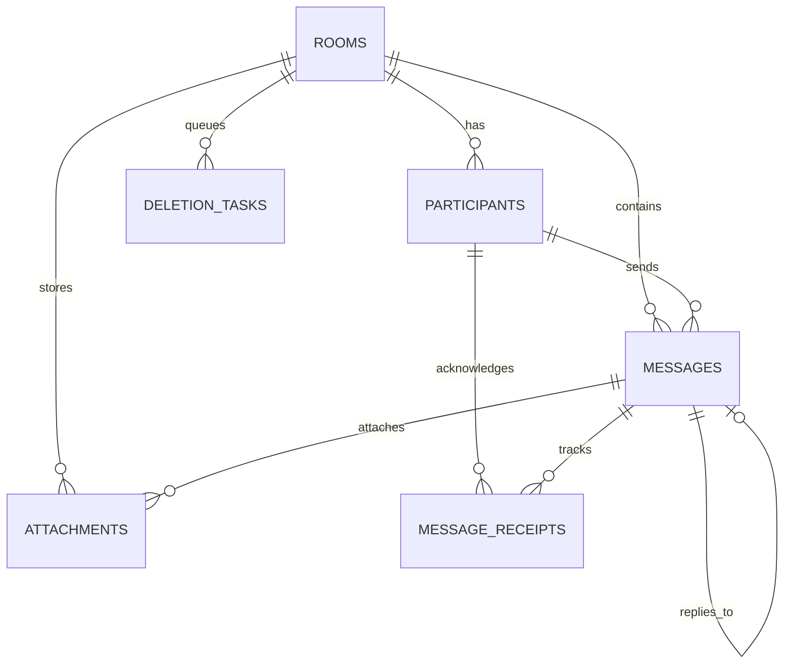

# TempChat Backend

> Production-minded, temporary-only, anonymous real-time messaging platform backend built with FastAPI, PostgreSQL, SQLAlchemy 2 Async, WebSockets, and Argon2id.

---

## 1. Overview & Privacy Principles

**TempChat** is designed from the ground up with **zero long-term user retention**:
- **No permanent accounts**: No registration, no passwords, no email addresses, no phone numbers, and no user profiles.
- **Cryptographic Guest Tokens**: Ephemeral tokens (`secrets.token_urlsafe(32)`) generated upon room creation or joining. Only their SHA-256 hashes are persisted in the database.
- **Argon2id Room Passwords**: Optional room protection uses the memory-hard Argon2id hashing algorithm.
- **Single-Use WebSocket Tickets**: WebSocket connections never expose raw tokens in URLs. A short-lived (60s), single-use ticket must be obtained from an authenticated REST endpoint.
- **Automated UTC Expiration**: A dedicated background worker utilizes `SELECT ... FOR UPDATE SKIP LOCKED` to lock and purge expired rooms, cascading deletes through database entities and purging physical media files from disk or S3 via an outbox queue.

---

## 2. Technology Stack

- **Python 3.12+**
- **FastAPI**: Asynchronous REST API and WebSocket gateway
- **PostgreSQL**: Relational database with full ACID compliance and cascade rules
- **SQLAlchemy 2 Async ORM**: Fully typed declarative models with `selectin` eager loading
- **asyncpg**: High-performance asynchronous PostgreSQL driver
- **Alembic**: Database schema migrations
- **Pydantic v2**: High-speed request validation and serialization
- **Argon2-cffi**: Room password hashing
- **Pytest & pytest-asyncio**: Comprehensive unit and integration test suite
- **Docker & Docker Compose**: Containerized multi-service deployment
- **Ruff**: Modern linter and formatter

---

## 3. Database Schema



### Tables
1. **`rooms`**: `id` (UUID PK), `code` (Unique invite code), `room_type` (`private` or `group`), `password_hash` (nullable Argon2), `host_participant_id`, `max_members`, `created_at`, `expires_at`, `status` (`active`, `deleting`, `expired`).
2. **`participants`**: `id` (UUID PK), `room_id` (FK to rooms CASCADE), `nickname`, `token_hash` (SHA-256 unique index), `is_host`, `joined_at`, `last_seen_at`.
3. **`messages`**: `id` (UUID PK), `room_id` (FK CASCADE), `sender_id` (FK CASCADE), `type` (`text`, `image`, `file`, `audio`), `content`, `reply_to_id` (Self FK SET NULL), `created_at`, `edited_at`, `deleted_at`.
4. **`attachments`**: `id` (UUID PK), `message_id` (FK CASCADE), `room_id` (FK CASCADE), `storage_key` (Unique), `original_filename`, `mime_type`, `size_bytes`, `media_type`, `created_at`.
5. **`message_receipts`**: `id` (UUID PK), `message_id` (FK CASCADE), `participant_id` (FK CASCADE), `delivered_at`, `read_at`.
6. **`deletion_tasks`**: `id` (UUID PK), `room_id`, `storage_keys` (JSON list), `status`, `retry_count`, `error_log`, `created_at`, `updated_at`.

---

## 4. REST API Specification

All REST responses adhere to this uniform contract:

**Success:**
```json
{
  "success": true,
  "data": { ... },
  "error": null
}
```

**Error:**
```json
{
  "success": false,
  "data": null,
  "error": {
    "code": "ROOM_EXPIRED",
    "message": "This temporary room has expired."
  }
}
```

### Endpoints Matrix (`/api/v1`)

| Method | Path | Auth Required | Description |
|---|---|---|---|
| `POST` | `/api/v1/rooms` | No | Create room (private or group) with duration presets |
| `POST` | `/api/v1/rooms/join` | No | Join existing room with code & optional password |
| `GET` | `/api/v1/rooms/{room_id}` | Bearer Guest | Get room details and expiration timer |
| `GET` | `/api/v1/rooms/{room_id}/members` | Bearer Guest | List active participants & presence status |
| `POST` | `/api/v1/rooms/{room_id}/leave` | Bearer Guest | Gracefully leave room |
| `DELETE` | `/api/v1/rooms/{room_id}` | Bearer Guest (Host) | Host closes room (instant permanent purge) |
| `POST` | `/api/v1/rooms/{room_id}/ws-ticket` | Bearer Guest | Issue single-use short-lived WebSocket ticket |
| `GET` | `/api/v1/rooms/{room_id}/messages` | Bearer Guest | Paginated message history |
| `POST` | `/api/v1/rooms/{room_id}/messages` | Bearer Guest | Send text message or reply |
| `PATCH` | `/api/v1/rooms/{room_id}/messages/{message_id}` | Bearer Guest (Author) | Edit own message |
| `DELETE` | `/api/v1/rooms/{room_id}/messages/{message_id}` | Bearer Guest (Author/Host) | Soft-delete message content |
| `POST` | `/api/v1/rooms/{room_id}/messages/{message_id}/read` | Bearer Guest | Mark message as read |
| `POST` | `/api/v1/rooms/{room_id}/attachments` | Bearer Guest | Upload media file (multipart/form-data) |
| `GET` | `/api/v1/rooms/{room_id}/attachments/{attachment_id}` | Bearer Guest | Securely stream media file |
| `GET` | `/health` | No | Liveness health check |
| `GET` | `/ready` | No | Database readiness check |

---

## 5. WebSocket Real-Time Protocol

**Endpoint:**
```
GET /api/v1/ws/rooms/{room_id}?ticket={ONE_TIME_TICKET}
```

All WebSocket messages adhere to this envelope:
```json
{
  "event": "message.new",
  "room_id": "3fa85f64-5717-4562-b3fc-2c963f66afa6",
  "event_id": "evt_a8f9c2d1",
  "timestamp": "2026-11-01T09:10:00Z",
  "data": {}
}
```

### Supported Events
- `room.joined`: Member joined the room.
- `room.member_left`: Member disconnected.
- `room.members`: Initial member presence roster.
- `message.new`: Real-time chat message broadcast.
- `message.delivered`: Message delivery receipt.
- `message.read`: Message read receipt.
- `message.deleted`: Message deletion indicator.
- `typing.start`: User typing event (throttled).
- `typing.stop`: User stopped typing (or automatically timed out after 5s).
- `room.expiring`: Expiration warning.
- `room.expired`: Room has expired; sockets closed.
- `error`: Error payload.

---

## 6. Expiration & Durable Cleanup

1. **Background Expiration Worker**:
   - Runs every 15 seconds.
   - Executes `SELECT ... FOR UPDATE SKIP LOCKED` on expired active rooms.
   - Marks status as `deleting`.
   - Sends `room.expired` event and disconnects all connected WebSockets.
   - Gathers all attachment `storage_key`s and inserts a task into `deletion_tasks`.
   - Deletes media files from local disk or S3 bucket.
   - Cascades deletion of the `Room` record in PostgreSQL (removing all messages, attachments, participants, and receipts).
2. **Storage Outbox Worker**:
   - Runs every 60 seconds.
   - Retries any failed storage deletion tasks with exponential backoff, preventing orphaned files.

---

## 7. Quickstart & Deployment

### Local Development Setup

```bash
# 1. Clone repository
git clone <repo-url> tempchat
cd tempchat

# 2. Set up virtual environment
python3 -m venv .venv
source .venv/bin/activate

# 3. Install dependencies
pip install -r requirements.txt aiosqlite

# 4. Copy environment configuration
cp .env.example .env

# 5. Run database migrations
alembic upgrade head

# 6. Start API server
uvicorn app.main:app --reload --port 8000
```

Interactive Swagger UI documentation is available at:  
👉 **`http://localhost:8000/docs`**

---

### Running with Docker Compose

```bash
docker-compose up --build -d
```

Services:
- **`tempchat_db`**: PostgreSQL 16 on port `5432`
- **`tempchat_api`**: FastAPI backend on port `8000`

---

### Running Automated Tests

```bash
pytest -v
```

All 19 unit and integration tests run in an isolated in-memory test database with mocked storage.

---

## 8. Retention & Privacy Notice

While TempChat completely purges server-side database records, metadata, and physical storage files upon room expiration:
- Server operators cannot control screenshots or downloads made by other participants before room expiration.
- Third-party backup systems or low-level block storage snapshots should have independent retention policies configured in production infrastructure.
